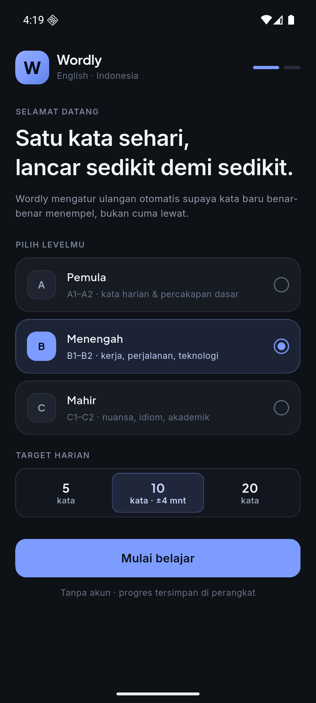
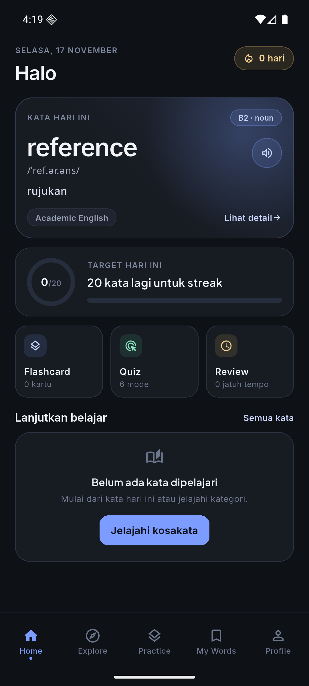
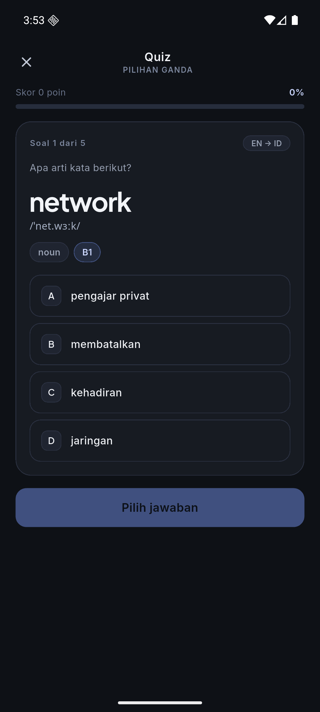

# Wordly

Aplikasi Android untuk belajar kosakata **Inggris–Indonesia** dengan
pengulangan berjarak (SM-2). Offline-first, tanpa akun, tanpa iklan.

13 kategori · **507 kata** · flashcard · 6 mode kuis · review terjadwal otomatis.

<p align="center">
  
  
  
</p>

---

## Fitur

| | |
|---|---|
| 🚀 **Onboarding** | Pilih level (A1–C2) dan target harian sekali, bisa diubah kapan saja |
| 🏠 **Home** | Kata hari ini + audio, target harian, streak, kata jatuh tempo |
| 🧭 **Explore** | 13 kategori, filter level, pencarian Inggris ↔ Indonesia |
| 📖 **Detail kata** | Terjemahan, definisi, IPA, contoh kalimat + terjemahan, sinonim/antonim, jadwal ulangan |
| ⭐ **Kata Saya** | Favorit, riwayat, belum dikuasai, dikuasai |
| 🃏 **Flashcard** | 5–20 kartu, ketuk untuk balik, geser kiri/kanan, kata salah muncul lagi |
| ✅ **Quiz** | Pilihan ganda, EN→ID, ID→EN, isi rumpang, listening, ejaan |
| 🔁 **Review terjadwal** | Antrean SM-2: prioritas kata paling terlambat & paling sering salah |
| ⚙️ **Pengaturan** | Tema gelap/terang, level, target harian, ukuran teks 85–130% |

Semua progres tersimpan lokal dan bertahan setelah aplikasi ditutup.

---

## Teknologi

| Kebutuhan | Pilihan |
|---|---|
| Framework | Flutter 3.50 (Dart 3.14), paket `material_ui` |
| State | Riverpod 3.5 |
| Database | Drift/SQLite — dua file: `vocab.db` (konten) & `user.db` (progres) |
| Navigasi | go_router 18 (`StatefulShellRoute` untuk bottom nav) |
| Audio | `flutter_tts` (mesin TTS perangkat, offline) |
| Preferensi | `shared_preferences` |
| Pencarian | SQLite FTS5 (+ fallback LIKE) |

---

## Menjalankan

**Prasyarat:** Flutter SDK stable, Android SDK (API 36), JDK 21, emulator atau
perangkat Android 7.0+ (API 24).

```bash
flutter pub get
flutter run
```

Kalau baru pertama kali mengubah skema database:

```bash
dart run build_runner build
```

### Perintah harian

```bash
flutter analyze                          # lint & type check
flutter test                             # unit test
dart run tool/validate_vocab.dart        # validasi konten kosakata
flutter run                              # jalankan aplikasi
```

### Menyalakan emulator

```bash
# dari Android Studio: Device Manager → jalankan AVD
# atau lewat terminal (renderer software, paling stabil):
emulator -avd <nama_avd> -no-boot-anim -gpu swiftshader_indirect
```

Panduan lengkap untuk mesin ini: [`docs/CARA-JALAN.md`](docs/CARA-JALAN.md).

---

## Build APK

```bash
# Debug (untuk uji cepat)
flutter build apk --debug

# Release per arsitektur (ukuran lebih kecil)
flutter build apk --release --split-per-abi

# Untuk Google Play
flutter build appbundle --release
```

Sebelum rilis, siapkan keystore dan `android/key.properties` (jangan di-commit),
ganti `applicationId` bila perlu, lalu uji di perangkat nyata.

---

## Struktur proyek

```
lib/
├─ app/            # bootstrap, router, shell
├─ core/
│  ├─ db/          # Drift: vocab.db + user.db, seeder, repository
│  ├─ design/      # palet warna, tipografi, spacing, tema
│  ├─ settings/    # preferensi persisten
│  ├─ srs/         # algoritma SM-2
│  ├─ audio/       # TTS
│  └─ widgets/     # komponen reusable
└─ features/       # onboarding, home, explore, word_detail, my_words,
                   # flashcards, quiz, review, practice, profile
assets/
├─ vocab/          # 13 berkas JSON konten (507 kata)
├─ fonts/          # TTF: Plus Jakarta Sans, Inter, Noto Sans
└─ branding/       # ikon & logo splash
tool/              # validator konten, generator aset
docs/              # panduan, screenshot, arsip perancangan
src/ + mockups/    # referensi desain (HTML & PNG), bukan bagian build
```

---

## Konten kosakata

Setiap berkas `assets/vocab/*.json` berisi satu kategori dan daftar kata dengan
13 field (kata, terjemahan, definisi, IPA, jenis kata, level, CEFR, contoh
kalimat + terjemahan, sinonim, antonim).

Konten divalidasi dengan:

```bash
dart run tool/validate_vocab.dart
# 13 kategori · 507 kata · 0 error · 0 peringatan
```

Aplikasi mengimpor ulang konten secara otomatis ketika isi aset berubah, **tanpa
menghapus progres pengguna**. Detail skema & format ada di
[`docs/PERANCANGAN.md`](docs/PERANCANGAN.md).

---

## Dokumentasi

| Berkas | Isi |
|---|---|
| [`docs/PERANCANGAN.md`](docs/PERANCANGAN.md) | Perancangan terkini: fitur, design system, arsitektur, skema DB, SM-2, roadmap |
| [`AGENTS.md`](AGENTS.md) | Aturan kontribusi/agen: konvensi kode, perintah, definition of done |
| [`docs/CARA-JALAN.md`](docs/CARA-JALAN.md) | Setup mesin pengembangan & troubleshooting |
| [`docs/arsip/perancangan-v0.1.md`](docs/arsip/perancangan-v0.1.md) | Brief awal + rencana backend (FastAPI/PostgreSQL) |

---

## Status & lisensi

Versi **0.1.0** — fungsional untuk dipakai harian; rilis toko belum disiapkan.

- Kode: tentukan lisensi sebelum publikasi (proprietary atau MIT).
- Font: SIL Open Font License (Plus Jakarta Sans, Inter, Noto Sans).
- Ikon & splash: dibuat khusus untuk proyek ini (`tool/make_brand_assets.py`).
- Konten kosakata: ditulis untuk proyek ini; jangan menyalin dari kamus atau
  aplikasi berhak cipta.
